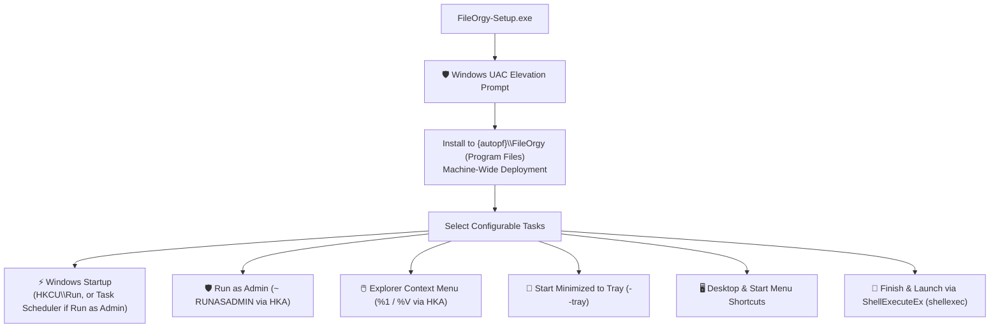
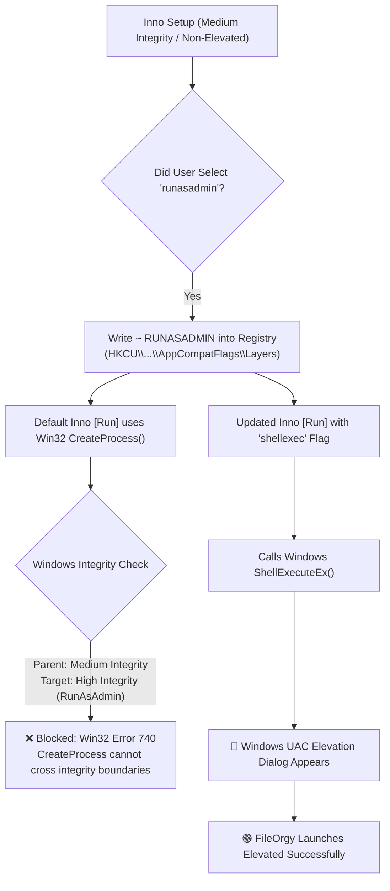

# FileOrgy: Windows Setup Installer & Deployment Guide

Welcome to the **FileOrgy Setup & Deployment Guide**. This document outlines how to install, configure, silently deploy, and cleanly uninstall FileOrgy using the native Windows Setup executable (`FileOrgy-Setup.exe` / `FileOrgy-Setup-vX.Y.Z.exe`), and how in-app updates work.

---

## 1. Overview & Setup Architecture

FileOrgy is packaged using an ultra-lean, modern **Inno Setup 6** installer compiler:
* **Installer Binary:** `FileOrgy-Setup-vX.Y.Z.exe` (plus a `FileOrgy-Setup.exe` copy that always points at the latest), attached to every [GitHub Release](https://github.com/aadilahammad86/FileOrgy/releases/latest). The version is stamped by CI via `ISCC.exe /DMyAppVersion=X.Y.Z`; local builds without that switch fall back to `1.0.0`.
* **Portable Build:** `FileOrgy-vX.Y.Z-portable.zip` (self-contained single-file `win-x64`, no installer).
* **Target Architecture:** Windows 10 / 11 (64-bit x64)
* **Compression:** LZMA2/Ultra64 solid compression
* **Privilege Model:** Defaults to `PrivilegesRequired=admin` (machine-wide installation into `C:\Program Files\FileOrgy`, prompting for standard Windows UAC elevation on launch).
* **Launch Architecture:** Uses Windows `ShellExecuteEx` (`shellexec`) on completion, supporting seamless UAC consent prompts without Win32 Error 740.



---

## 2. Interactive Graphical Installation (GUI)

1. **Download / Locate Installer:**  
   Download `FileOrgy-Setup.exe` from the [latest GitHub Release](https://github.com/aadilahammad86/FileOrgy/releases/latest) and double-click it. Windows will display the User Account Control (UAC) prompt requesting administrative approval.
2. **Select Destination Location:**  
   * Standard machine-wide location: `C:\Program Files\FileOrgy`
   * Or specify a custom folder on your system.
3. **Select Additional Tasks (Configurable Toggles):**  
   Configure background monitoring, startup integration, privilege levels, and shortcuts.
4. **Ready to Install:**  
   Review the selected options and click **Install**. Extraction and registry configuration complete in 1–2 seconds.
5. **Finish & Launch:**  
   Choose whether to launch FileOrgy immediately.

---

## 3. Configurable Toggles Explained

During the **Select Additional Tasks** wizard step, the installer offers five distinct configuration toggles:

### 1. ⚡ Windows Startup (`autostart`)
* **Default:** Enabled (`checkedonce`)
* **Technical Mechanism:**
  * **Standard (default):** Writes a `FileOrgy` value to `HKCU\Software\Microsoft\Windows\CurrentVersion\Run`.
  * **When `runasadmin` is also selected:** Registers a Task Scheduler task named `FileOrgy_ElevatedAutoStart` (`/sc onlogon /rl HIGHEST`) instead of the `Run` key. See [Elevated Autostart](#elevated-autostart-via-task-scheduler) below.
* **Behavior:** FileOrgy automatically launches whenever your Windows user logs in.
* **Security & Isolation:** The `Run` key entry only affects the installing user's account.
* **Changing it later:** The **Launch FileOrgy on Windows Startup** checkbox in **⚙️ Settings** keeps both mechanisms in sync. It uses the `Run` key for a normal install and the elevated scheduled task when the executable is flagged `~ RUNASADMIN`, and removes whichever one is not in use.

### 2. 🔔 Start Minimized to System Tray (`startminimized`)
* **Default:** Enabled (`checkedonce`)
* **Technical Mechanism:** Appends the `--tray` argument to the Windows Startup command (`Run` value or scheduled task action):
  ```ini
  "{app}\FileOrgy.exe" --tray
  ```
* **Behavior:** When Windows boots, FileOrgy starts silently in the background notification tray (near the clock) without popping open the main UI window. Real-time folder hooks immediately begin with 0.00% idle CPU and ~18MB RAM footprint.

### 3. 🖱️ Windows Explorer Context Menu (`contextmenu`)
* **Default:** Enabled (`checkedonce`)
* **Technical Mechanism:** Registers context menu handlers under:
  * `HKA\Software\Classes\Directory\shell\FileOrgy` (when right-clicking any folder; HKLM when admin, HKCU when per-user)
  * `HKA\Software\Classes\Directory\Background\shell\FileOrgy` (when right-clicking whitespace inside a folder)
* **Behavior:** Adds the **"Organize with FileOrgy"** action with the application icon to Windows Explorer. Clicking this instantly triggers an in-place organizational scan on that specific directory.
* **Arguments:**
  * Folder item: `"{app}\FileOrgy.exe" --scan "%1"`
  * Folder background: `"{app}\FileOrgy.exe" --scan "%V"`

### 4. 🛡️ Run as Administrator (`runasadmin`)
* **Default:** Disabled (`unchecked`)
* **Technical Mechanism:** Sets `~ RUNASADMIN` in `HKA\Software\Microsoft\Windows NT\CurrentVersion\AppCompatFlags\Layers`.
* **Behavior:** Forces Windows to elevate FileOrgy to High Integrity on launch.
* **Important Operational Notes:**
  > [!WARNING]
  > **Startup Compatibility:** Windows Userinit/Explorer deliberately **blocks elevated applications from launching via the standard `Run` registry key at logon** to prevent silent UAC elevation. FileOrgy works around this: when both "Run as Administrator" and "Windows Startup" are selected, setup registers the elevated `FileOrgy_ElevatedAutoStart` scheduled task instead, so FileOrgy still starts at logon, elevated and without a UAC prompt.
  >
  > **UIPI Drag-and-Drop:** Windows User Interface Privilege Isolation (UIPI) blocks file drag-and-drop between medium-integrity Windows Explorer and high-integrity elevated applications.
  >
  > **Recommendation:** FileOrgy is designed to operate on user directories (`Downloads`, `Documents`, `Pictures`) and does **not** require administrator privileges. Leave this toggle disabled unless monitoring system-protected directories.

### 5. 🖥️ Desktop & Start Menu Shortcuts (`desktopicon`, `startmenuicon`)
* **Start Menu (`startmenuicon`):** Enabled by default. Places `FileOrgy.lnk` in `{autoprograms}`.
* **Desktop Shortcut (`desktopicon`):** Disabled by default. Places `FileOrgy.lnk` on `{autodesktop}`.

---

### Elevated Autostart via Task Scheduler

| Selected tasks | Autostart mechanism |
| :--- | :--- |
| `autostart` (no `runasadmin`) | `HKCU\...\Run` value `FileOrgy` |
| `autostart` + `runasadmin` | Scheduled task `FileOrgy_ElevatedAutoStart`, trigger **At log on**, **Run with highest privileges** |
| `runasadmin` without `autostart`, or neither | No autostart; any leftover elevated task is deleted |

The `--tray` argument is added in both cases when `startminimized` is selected.

**Verify the task:**
```powershell
schtasks /query /tn "FileOrgy_ElevatedAutoStart" /v /fo list
```

**Repair an existing install manually:** if FileOrgy is flagged to run as administrator but doesn't start at logon (e.g. it was installed with an older version of setup), run `run_setup_as_admin.bat` from the repository root. It self-elevates via UAC and runs `tools\setup_elevated_autostart.ps1`, which removes the blocked `Run` entries and registers the elevated task. The script accepts `-TargetExe` (default `C:\Program Files\FileOrgy\FileOrgy.exe`) and `-WorkspaceDir`. The batch file calls the script by absolute path, so edit that path if your clone lives elsewhere.

`tests\reboot_log_catcher.ps1` can be used to log whether FileOrgy actually came up after a reboot when debugging autostart.

---

## 4. Silent & Automated Enterprise Deployment

For network administrators, unattended scripts, or automated provisioning (PowerShell / Intune / SCCM), the installer supports standard Inno Setup command-line switches:

### Common Silent Switches

| Switch | Description |
| :--- | :--- |
| `/SILENT` | Displays the wizard progress window, but requires no user interaction. |
| `/VERYSILENT` | Headless silent installation. No wizard, progress dialog, or UI is shown. |
| `/SUPPRESSMSGBOXES` | Automatically suppresses message boxes and answers defaults. |
| `/NORESTART` | Prevents the installer from restarting the system if files are in use. |
| `/DIR="C:\Path"` | Overrides the default installation target directory. |
| `/LOG="install.log"` | Records a verbose installation log for troubleshooting. |
| `/TASKS="comma,separated"` | Specifies exactly which tasks to enable. |
| `/MERGETASKS="tasks"` | Merges specific tasks with the default task set (prefix with `!` to negate). |

---

### Silent Deployment Recipes

#### Recipe 1: Recommended Silent Background Install (Default Toggles)
Installs headlessly with Windows Startup, Start Minimized to Tray, Context Menu, and Start Menu shortcut:
```powershell
.\FileOrgy-Setup.exe /VERYSILENT /SUPPRESSMSGBOXES /NORESTART
```

#### Recipe 2: Portable / On-Demand Install (No Startup, Desktop Icon Only)
Installs without Windows startup or tray mode, adding desktop and context menu shortcuts:
```powershell
.\FileOrgy-Setup.exe /VERYSILENT /TASKS="desktopicon,startmenuicon,contextmenu"
```

#### Recipe 3: Elevated Enterprise Admin Deployment
Machine-wide install to `C:\Program Files\FileOrgy` with full logging:
```powershell
.\FileOrgy-Setup.exe /VERYSILENT /DIR="C:\Program Files\FileOrgy" /LOG="C:\Temp\fileorgy_install.log"
```

#### Recipe 4: Elevated Autostart (Monitoring Protected Folders)
Runs FileOrgy as administrator and starts it elevated at logon via Task Scheduler:
```powershell
.\FileOrgy-Setup.exe /VERYSILENT /SUPPRESSMSGBOXES /NORESTART /TASKS="startmenuicon,contextmenu,autostart,startminimized,runasadmin"
```

---

## 5. Clean Uninstallation (Zero Debris)

FileOrgy adheres to strict Windows uninstallation cleanliness standards, ensuring **zero leftover registry keys or orphaned system settings**:

### Uninstallation Methods

1. **Via Windows 11 / 10 Settings:**
   * Open **Settings (`Win + I`)** ➔ **Apps** ➔ **Installed apps** (or *Apps & features*).
   * Search for **FileOrgy**.
   * Click the three dots `...` and select **Uninstall**.
2. **Via Control Panel:**
   * Open **Control Panel** ➔ **Programs and Features**.
   * Select **FileOrgy** and click **Uninstall**.
3. **Silent Scripted Uninstallation:**
   ```powershell
   # Uninstalls silently without user prompts
   & "C:\Program Files\FileOrgy\unins000.exe" /VERYSILENT /NORESTART
   ```

---

### Registry Cleanliness & Safety Guarantee

The uninstaller distinguishes between **shared system keys** and **application-owned keys**:

| Component | Uninstaller Directive | Safety Action |
| :--- | :--- | :--- |
| **Startup (`Run`)** | `uninsdeletevalue` | Deletes *only* the `FileOrgy` value. Shared system `Run` key is completely untouched. |
| **Elevated Autostart Task** | `[UninstallRun]` `schtasks /delete` | Deletes the `FileOrgy_ElevatedAutoStart` scheduled task if present. |
| **Privileges (`AppCompatFlags`)** | `uninsdeletevalue` | Deletes *only* the FileOrgy executable layer. Shared Windows system keys are preserved. |
| **Context Menu (Folder)** | `uninsdeletekey` | Recursively removes `Directory\shell\FileOrgy` and child command keys. |
| **Context Menu (Background)** | `uninsdeletekey` | Recursively removes `Directory\Background\shell\FileOrgy` and child command keys. |
| **Shortcuts & Binaries** | Automatic | All `.lnk` shortcuts, binaries, and auxiliary DLLs are removed. |

> [!NOTE]
> **User Data & Logs:**  
> User rule configurations and activity audit logs residing in `%LocalAppData%\FileOrgy\` (`config.json` and `logs\activity.jsonl`) are preserved so your custom workflows remain intact if you reinstall or upgrade. To remove all user data completely, simply delete the `%LocalAppData%\FileOrgy` folder after uninstalling.

---

## 6. Privilege Architecture, UAC Elevation & Troubleshooting (Error 740)

### Understanding Windows Privilege Models in FileOrgy

| Installation Mode | Privilege Level | Default Directory | Prompts for UAC on Launch? | Target Audience |
| :--- | :--- | :--- | :---: | :--- |
| **Setup (installer)** | Administrator (`PrivilegesRequired=admin`) | `C:\Program Files\FileOrgy` | **Yes** (UAC Shield dialog when setup starts) | Everyone |
| **App, default** | Standard user (Medium Integrity) | — | **No** | Monitoring user folders such as Downloads, Documents, Pictures |
| **App, `runasadmin`** | Administrator (High Integrity, `~ RUNASADMIN`) | — | **Yes** on manual launch; **no** at logon (scheduled task runs with highest privileges) | Monitoring protected system folders |

---

> [!NOTE]
> Early builds of setup used a per-user install (`PrivilegesRequired=lowest`, `%LocalAppData%\Programs\FileOrgy`) with no UAC prompt. Current releases always install machine-wide into Program Files.

---

### Deep Dive: Why Win32 Error 740 ("CreateProcess failed; code 740: The requested operation requires elevation") Occurred

If a user checked the **"Always run with Administrator privileges"** (`runasadmin`) toggle during setup, clicking **Finish** previously resulted in this error dialog:

> `Unable to execute file: ...\FileOrgy.exe`  
> `CreateProcess failed; code 740: The requested operation requires elevation.`



#### The Technical Root Cause:
* **Integrity Level Mismatch:** The setup wizard was running at **Medium Integrity** (standard user privileges).
* **AppCompat Flag Set:** Enabling `runasadmin` wrote `~ RUNASADMIN` to `HKCU\Software\Microsoft\Windows NT\CurrentVersion\AppCompatFlags\Layers` for `FileOrgy.exe`. This explicitly flags `FileOrgy.exe` as requiring **High Integrity** (Administrator privileges).
* **The Win32 `CreateProcess()` Limitation:** By default, Inno Setup's `[Run]` section calls the native Win32 `CreateProcess()` API. In Windows security architecture:
  - `CreateProcess()` **cannot cross an integrity boundary** from a non-elevated caller to an elevated child.
  - `CreateProcess()` **cannot trigger an interactive UAC prompt**.
  - When Windows detects that the target binary demands administrative rights while the caller lacks them, Windows aborts the process creation and returns Win32 error code 740 (`ERROR_ELEVATION_REQUIRED`).

---

### How the Updated Setup Resolves Error 740

The installer script has been updated with two robust safeguards:

#### 1. The `shellexec` Flag in the `[Run]` Directive
In `FileOrgy.iss`, the post-installation launch entry now includes `shellexec`:
```ini
[Run]
Filename: "{app}\{#MyAppExeName}"; Description: "{cm:LaunchProgram,{#StringChange(MyAppName, '&', '&&')}}"; Flags: nowait postinstall skipifsilent shellexec
```
* **How `shellexec` Fixes It:** Instead of `CreateProcess()`, Inno Setup invokes the Windows Shell API `ShellExecuteEx()`.
* **Automatic UAC Invocation:** When `ShellExecuteEx()` detects that `FileOrgy.exe` has the `~ RUNASADMIN` compatibility flag, it automatically calls the Windows Application Information service (Appinfo) to trigger the interactive UAC prompt:
  > *"Do you want to allow this app to make changes to your device?"*
* Once the user approves, FileOrgy launches with elevated administrator privileges cleanly with zero errors.

#### 2. Elevated Autostart via Task Scheduler
The `Run` registry key cannot start an elevated app at logon (see the warning under *Run as Administrator* in section 3). When `runasadmin` and `autostart` are both selected, setup registers the `FileOrgy_ElevatedAutoStart` task with `/rl HIGHEST` instead. See [Elevated Autostart via Task Scheduler](#elevated-autostart-via-task-scheduler).

---

## 7. In-App Updates

FileOrgy updates itself from GitHub Releases. No separate updater service is installed.

1. **Check:** On startup (if **Automatically check for updates on startup** is enabled in **⚙️ Settings**) or when you click **🔄 Check for Updates**, FileOrgy queries `https://api.github.com/repos/aadilahammad86/FileOrgy/releases/latest` and compares the release tag with its own version.
2. **Notify:** If a newer version exists, a **🚀 Update** banner appears in the header (**Install** / **✕** to dismiss), and Settings shows **🚀 View & Install Update**.
3. **Download:** The update dialog shows release notes and size, then downloads the best installer asset (preferring `FileOrgy-Setup-vX.Y.Z.exe`, then `FileOrgy-Setup.exe`) to `%TEMP%\FileOrgyUpdates\` with a progress bar.
4. **Install:** FileOrgy launches the downloaded installer (UAC prompt, since setup requires admin) and exits so its files can be replaced. Your previous task selections are remembered by setup, and `%LocalAppData%\FileOrgy\` (config and logs) is untouched.

> [!TIP]
> Offline or behind a proxy? Download the installer manually from the [Releases page](https://github.com/aadilahammad86/FileOrgy/releases/latest) and run it over the existing install.
