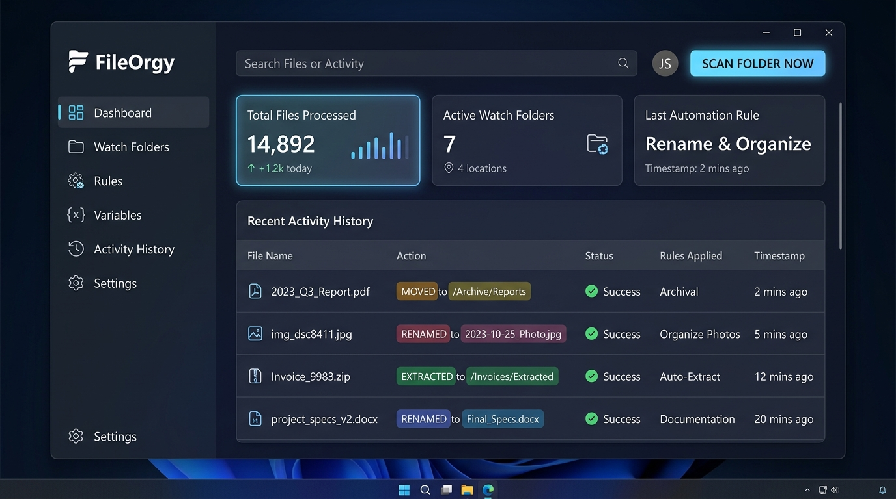

<div align="center">

# ⚡ FileOrgy — Automatic File Organizer for Windows

**Free, open-source Windows app that automatically sorts, renames, and cleans up your Downloads folder and any other folder in real time.**

[](https://github.com/aadilahammad86/FileOrgy/releases/latest)
[](https://github.com/aadilahammad86/FileOrgy/releases)
[](https://github.com/aadilahammad86/FileOrgy/actions/workflows/release.yml)


[](LICENSE)

[**⬇️ Download for Windows**](https://github.com/aadilahammad86/FileOrgy/releases/latest/download/FileOrgy-Setup.exe) · [🌐 Website](https://aadilahammad86.github.io/FileOrgy/) · [Tutorial](TUTORIAL.md) · [Install Guide](INSTALLER.md) · [Rules Guide](docs/RULES_AND_WORKFLOWS_GUIDE.md)



</div>

**FileOrgy** is an ultra-lightweight Windows file organizer and folder automation tool. It watches folders like **Downloads**, **Desktop**, and **Documents** 24/7 and automatically sorts files into folders by type, reads PDF and Office documents to rename invoices by date, extracts ZIP/RAR/7z archives, and cleans up old files, all with **0% idle CPU** and about **20 MB of RAM**.

Think of it as a free, rule-based alternative to tools like **DropIt** and **File Juggler**, or a Windows take on macOS **Hazel**: set up rules once, and your folders stay organized automatically.

Built on native **.NET 10 (Windows Desktop & WPF)**, FileOrgy uses Windows kernel I/O completion ports (`ReadDirectoryChangesW`) to ensure **0.0% idle CPU usage** and an ultra-lean memory footprint (~18MB to 25MB RAM).

### ✅ What FileOrgy Does
- 📂 **Organize your Downloads folder automatically** into Programs, Documents, Compressed, Pictures, Videos, Audio, and Others (250+ file types).
- 🧾 **Rename PDFs and invoices by their internal date**, e.g. `2026-09-14_invoice_acme.pdf`.
- 📦 **Auto-extract ZIP, RAR, 7z, and multipart archives**, then recycle the original.
- 🖼️ **Sort photos into year/month folders** using EXIF dates.
- 🧹 **Delete old files and empty folders** safely via the Recycle Bin.
- 🖱️ **Right-click any folder ➔ "Organize with FileOrgy"** for one-click cleanup.

---

## 🌟 Key Features

### 1. 👁️ Real-Time Folder Monitoring
- **Instant Detection**: Watches directories continuously for newly created, modified, or renamed files using native Windows kernel hooks.
- **Smart Debounce Engine**: Automatically coalesces rapid Windows file events (e.g., active downloads or large file copies) with customizable debounce delays (default `1200ms–1500ms`).
- **File Lock & Stability Protection**: Detects when third-party applications are still writing to a file, politely waiting until file locks are released before triggering workflows.
- **Transient File Filtering**: Automatically ignores temporary files (`*.tmp`, `*.crdownload`, `*.part`, `~$*`, `desktop.ini`, `Thumbs.db`).
- **Startup Catch-Up Scan**: On launch, FileOrgy can automatically scan all monitored folders to organize files that arrived while it wasn't running (toggle in **Settings**, enabled by default).

### 2. 🗂️ Automatic File Organization
- **Granular Condition Engine**: Match files by Name, Extension, Full Path, File Size, Created/Modified Dates, Extracted Document Content, Internal Document Date, or Custom Variables.
- **Operators**: `Equals`, `NotEquals`, `Contains`, `StartsWith`, `EndsWith`, `MatchesWildcard`, `MatchesRegex`, `InKeywordList`, `NotInKeywordList`, `GreaterThan`, `LessThan`, `OlderThanDays`, `NewerThanDays`, `IsEmptyFile`.
- **Match Logic**: Supports both `Match ALL (AND)` and `Match ANY (OR)` condition grouping.
- **In-Place Organization Presets**: Seven built-in category rules (Programs, Documents, Compressed, Pictures, Videos, Audio, Others) backed by 250+ file-type filters, sorting files into subfolders of the watched folder itself.
- **Catch-All "Others" Rule**: Any file whose type isn't matched by another rule's extension filters is routed to an in-place `Others` folder. The set of already-sorted extensions (`AllSortedExts`) is recomputed automatically from your enabled rules.
- **Conflict Resolution Strategies**:
  - `AutoRenameUnique`: Safely appends incremental counter `(1)`, `(2)` to prevent accidental overwrites.
  - `Overwrite`: Replaces destination file.
  - `Skip`: Retains existing destination and aborts move.
  - `KeepNewer`: Replaces only if source timestamp is newer.

### 3. 🏷️ Smart Dynamic Renaming
- **Template Tokens**:
  - `{filename}`: Full original filename with extension.
  - `{basename}`: Filename without extension.
  - `{ext}` / `{dotext}`: Extension without/with leading period.
  - `{date:format}`: Current system date/time (e.g., `{date:yyyy-MM-dd}`).
  - `{created:format}`: File creation timestamp.
  - `{modified:format}`: File modification timestamp.
  - `{doc_date:format}`: Internal extracted document date (e.g., `{doc_date:yyyy-MM-dd}`).
  - `{filesize}` / `{filesize_bytes}`: Human-readable or raw byte size.
  - `{parent}`: Name of parent folder.
  - `{directory}`: Full path of the folder containing the file (used by the in-place presets, e.g. `{directory}\Documents`).
  - `{counter:001}`: Incremental sequence number padded with zeroes (e.g., `001`, `002`).
  - `{var:VariableName}`: Custom variable substitution.
  - `{regex:GroupName}` / `{match:1}`: Captured regex groups from filename or document content.
- **Case Transformers**: Lowercase, Uppercase, Title Case, snake_case, kebab-case, or clean slug.
- **Filename Sanitizer**: Automatically cleans forbidden Windows characters (`\ / : * ? " < > |`).

### 4. 📄 Content-Based Processing
- **PDF Documents**: Native C# PDF text and metadata reader (powered by `UglyToad.PdfPig`). Extracts text and metadata without heavy external dependencies.
- **Office OpenXML (.docx, .xlsx, .pptx)**: Zero-dependency streaming extraction directly from the Office OpenXML container (`word/document.xml`, `xl/sharedStrings.xml`, `ppt/slides/slide*.xml`, and `docProps/core.xml`). No Microsoft Office installation required.
- **Plain Text & Code**: Reads `.txt`, `.csv`, `.tsv`, `.log`, `.md`, `.json`, `.xml`, `.html`, `.ini`, `.yaml`, `.sql`, `.cs`, `.py`, `.js`, `.ts` with streaming buffer safety to keep memory low.

### 5. 📅 Document Date Extraction
- **Multi-Tier Date Detection**:
  1. Internal document metadata (PDF `CreationDate`/`ModDate`, Office `dcterms:created`/`dcterms:modified`).
  2. Image EXIF metadata (`DateTimeOriginal` / `CreateDate`) for JPEG and TIFF images.
  3. Text pattern scanning for ISO dates (`YYYY-MM-DD`), US/EU numeric formats (`MM/DD/YYYY`, `DD/MM/YYYY`), and written dates (`September 5, 2026`, `5-Sep-2026`).
  4. Invoice date anchors (`Invoice Date:`, `Dated:`, `Statement Date:`).

### 6. 🧹 Automated Storage Cleanup
- **Retention Rules**: Automatically remove files older than $N$ days, hours, or minutes.
- **Safe Windows Recycle Bin**: Direct P/Invoke integration with native Windows `shell32.dll` (`SHFileOperationW`). Recycled files can be restored anytime from the Windows Recycle Bin.
- **Permanent Deletion Toggle**: Optional secure permanent file removal when preferred.
- **Empty Folder Cleaner**: Recursively prunes empty directories left behind after moves or cleanups.
- **System Directory Protection**: Built-in safeguards prevent operations on protected system directories (`Windows`, `System32`, `Program Files`, drive roots).

### 7. 📦 Archive Auto-Extraction (Including Multipart)
- **Wide Format Support**: Extracts `.zip`, `.tar`, `.gz`, `.tgz`, `.bz2`, `.7z`, and `.rar` archives.
- **Multipart Archive Intelligence**: Automatically detects split archives (`.part01.rar`, `.part02.rar`, `.zip.001`, `.7z.001`) and triggers extraction only on primary volumes while tracking all companion parts.
- **Zip-Slip Protection**: Validates normalized extraction targets to protect against malicious directory traversal archives.
- **Post-Extraction Actions**: Safe Recycle Bin disposal, permanent delete, archive moving, or retention.
- **Pipeline Re-Queue**: Option to immediately organize extracted contents through subsequent workflow rules!

### 8. 🔗 Multi-Step Workflows
- **Pipelines**: Rules chain multiple steps into a single ordered sequence:
  ```
  Incoming File
      │
      ▼
  [Step 1: Extract Archive] ──▶ (Extracts ZIP/7Z to staging folder)
      │
      ▼
  [Step 2: Inspect Document] ──▶ (Parses text from PDF / Word / Excel)
      │
      ▼
  [Step 3: Extract Date] ──▶ (Resolves internal document date)
      │
      ▼
  [Step 4: Regex Capture] ──▶ (Captures invoice number into {match:1})
      │
      ▼
  [Step 5: Smart Rename] ──▶ ({doc_date:yyyy-MM-dd}_INV-{match:1}_{basename})
      │
      ▼
  [Step 6: Move / Route] ──▶ (Routes to D:\Invoices\{doc_date:yyyy}\{doc_date:MM}\)
      │
      ▼
  [Step 7: Recycle Original] ──▶ (Safe Windows Recycle Bin)
  ```

### 9. 🧩 Variables & Reusable Lists
- **Custom Variables**: Global key-value dictionary (e.g., `BaseStorage`, `ClientPrefix`, `TaxYear`) accessible via `{var:Key}` in file paths, templates, and rules.
- **Reusable Keyword Lists**: Define named lists (e.g., `FinancialKeywords`, `DocumentExts`, `ArchiveExts`). Update a list in one place and all rules using `InKeywordList` update instantly.

### 10. 🧭 Friendly Rule Editor & In-App Guide
- **Plain-Language Labels**: Condition targets, operators, and step types are shown with friendly descriptions instead of raw enum names.
- **Clickable Token Chips**: Insert rename/path tokens (`{basename}`, `{doc_date:yyyy-MM-dd}`, `{var:Name}`, ...) with one click.
- **Live Keyword Previews**: See the contents of a selected keyword list right inside the condition editor.
- **💡 Rule Guide**: An interactive in-app guide (Rules & Workflows tab) explaining conditions, steps, and tokens with examples. Also available as [docs/RULES_AND_WORKFLOWS_GUIDE.md](docs/RULES_AND_WORKFLOWS_GUIDE.md).

### 11. 🚀 In-App Updates
- **GitHub Releases Integration**: Checks the [latest release](https://github.com/aadilahammad86/FileOrgy/releases/latest) on startup (toggle in **Settings**) or on demand via **🔄 Check for Updates**.
- **Update Banner & Dialog**: When a newer version exists, a banner appears in the header; the update dialog shows release notes, download size, and a live progress bar.
- **Seamless Install**: The installer is downloaded to `%TEMP%\FileOrgyUpdates\`, launched, and FileOrgy exits so setup can replace it cleanly.

### 12. 📊 Comprehensive Logging & Activity Tracking
- **Live Activity Feed**: Real-time streaming log of all file detections, rules matched, renames, moves, extractions, and cleanups.
- **Persistent JSONL Storage**: Operations saved to disk in JSON Lines format (`%LocalAppData%\FileOrgy\logs\activity.jsonl`) with rolling retention.
- **Exporting**: One-click export to **CSV** and **JSON**.
- **Windows Explorer Integration**: Right-click any log entry to "Open Containing Folder" or "Copy Path".

---

## ⚡ Near-Zero Resource Architecture

| Metric | Performance |
|---|---|
| **Idle CPU Usage** | **0.00%** (Windows Kernel I/O Completion Ports) |
| **Active Processing CPU** | Under 1.5% (Bounded concurrency queue, max 2 worker threads) |
| **Working Set Memory (RAM)** | **~18 MB – 25 MB** |
| **Disk I/O** | Batched asynchronous flushes every 2 seconds |
| **Background Mode** | Minimizes to Windows System Tray (`NotifyIcon`) |

---

## 🚀 Getting Started

> 📖 **Guides & Documentation:**
> - [Setup & Deployment Guide (INSTALLER.md)](INSTALLER.md) — Windows installer guide, silent deployment switches, configurable toggles, and clean uninstallation.
> - [Visual Workflow Guide & Tutorial (TUTORIAL.md)](TUTORIAL.md) — UI walkthrough, 7-category in-place organization architecture, and custom rule recipes.
> - [Rules & Workflows Guide (docs/RULES_AND_WORKFLOWS_GUIDE.md)](docs/RULES_AND_WORKFLOWS_GUIDE.md) — Conditions, operators, workflow steps, and tokens explained with examples.

### 📦 Windows Setup Installer (Recommended)

FileOrgy includes a native Windows Setup executable with configurable installation toggles:

1. Download **`FileOrgy-Setup.exe`** (always the latest) or a versioned **`FileOrgy-Setup-vX.Y.Z.exe`** from the [GitHub Releases page](https://github.com/aadilahammad86/FileOrgy/releases/latest). A portable `FileOrgy-vX.Y.Z-portable.zip` is published with every release too.
2. Customize your installation with interactive toggles:
   - **⚡ Run at Windows Startup**: Automatically starts FileOrgy on user logon (via Task Scheduler when combined with *Run as Administrator*).
   - **🔔 Start Minimized to Tray**: Runs silently in the notification area with 0.00% idle CPU.
   - **🖱️ Explorer Context Menu**: Adds right-click *"Organize with FileOrgy"* to folders.
   - **🛡️ Run with Administrator Privileges**: Optional elevation for protected folders.
   - **🖥️ Shortcuts**: Optional Desktop and Start Menu icons.
3. Click **Install** to complete installation in seconds.

> [!TIP]
> **Privileges & UAC:** The installer asks for administrator approval and installs machine-wide into `C:\Program Files\FileOrgy`. The app itself runs as a standard user unless you enable *Run with Administrator Privileges*. In that case setup launches it via `ShellExecuteEx` (preventing Win32 error 740) and registers autostart as an elevated Task Scheduler task, because Windows silently skips elevated apps listed in the `Run` registry key at logon. See [INSTALLER.md](INSTALLER.md#6-privilege-architecture-uac-elevation--troubleshooting-error-740) for full details.

#### Silent / Enterprise Deployment
```powershell
# Headless unattended installation with default settings:
.\FileOrgy-Setup.exe /VERYSILENT /SUPPRESSMSGBOXES /NORESTART

# Custom task selection:
.\FileOrgy-Setup.exe /VERYSILENT /TASKS="autostart,startminimized,contextmenu"
```

#### Clean Uninstallation
Uninstall via **Windows Settings ➔ Installed apps ➔ FileOrgy ➔ Uninstall**, or run:
```powershell
& "C:\Program Files\FileOrgy\unins000.exe" /VERYSILENT /NORESTART
```
*Guarantees zero orphaned registry keys on shared system paths, and removes the elevated autostart task if one was created.*

### 🔄 Updating
FileOrgy checks for new releases automatically on startup. You can also open **⚙️ Settings ➔ Software Updates & Repository Releases**, click **🔄 Check for Updates**, then **🚀 View & Install Update**. Your rules, variables, and logs in `%LocalAppData%\FileOrgy\` are preserved across updates.

### Prerequisites
- Windows 10 / 11 (x64 / ARM64)
- .NET 10.0 Runtime (or .NET 10 Desktop SDK for building from source)

### Building from Source

```powershell
# Clone or navigate to the repository
cd C:\Users\swalih\FileOrgy

# Restore and build the solution
dotnet build FileOrgy.slnx -c Release

# Run automated tests (core engine, advanced features, update version logic)
dotnet test FileOrgy.slnx

# Run FileOrgy
dotnet run --project src/FileOrgy.App/FileOrgy.App.csproj
```

### CLI / Background Startup Options

```powershell
# Start minimized directly to Windows notification area / system tray
FileOrgy.App.exe --tray

# Or with --minimized
FileOrgy.App.exe --minimized

# Organize a specific folder immediately (used by the Explorer context menu)
FileOrgy.App.exe --scan "C:\Users\<you>\Downloads"
```

### Releases (CI)
Every push to `master` runs `.github/workflows/release.yml`, which:
1. Computes the next patch version from the latest `vX.Y.Z` tag (e.g. `v1.0.8` ➔ `v1.0.9`).
2. Runs the unit tests.
3. Publishes a self-contained single-file `win-x64` build stamped with that version.
4. Compiles the Inno Setup installer (`/DMyAppVersion=X.Y.Z`) and a portable zip.
5. Creates a GitHub Release with `FileOrgy-Setup-vX.Y.Z.exe`, `FileOrgy-Setup.exe`, and `FileOrgy-vX.Y.Z-portable.zip`.

---

## 📁 Solution Architecture

```
FileOrgy/
├── FileOrgy.slnx                       # Modern .NET 10 Solution
├── src/
│   ├── FileOrgy.Core/                  # High-performance automation engine
│   │   ├── Models/
│   │   │   ├── Models.cs               # Rules, Conditions, Steps, Config, Logs
│   │   │   └── WorkflowContext.cs      # File processing context & state
│   │   ├── Services/
│   │   │   ├── FileSystemMonitorService.cs # Kernel-level folder watcher & debouncer
│   │   │   ├── ConditionEvaluator.cs   # Multi-target rule matching engine
│   │   │   ├── WorkflowEngine.cs       # Multi-step pipeline execution
│   │   │   ├── SmartRenamer.cs         # Token-based dynamic renamer
│   │   │   ├── DocumentInspector.cs    # PDF, Office OpenXML & text parser
│   │   │   ├── ArchiveExtractor.cs     # ZIP, 7Z, RAR & multipart extractor
│   │   │   ├── WindowsRecycleBin.cs    # Native shell32 Recycle Bin P/Invoke
│   │   │   ├── ConfigService.cs        # JSON config loader & default presets
│   │   │   ├── LogManager.cs           # Async circular log buffer & export
│   │   │   ├── UpdateHelper.cs         # Release tag parsing & installer asset selection
│   │   │   └── FileOrgyOrchestrator.cs # Central coordinator & concurrency pool
│   │   └── Utils/
│   │       ├── FileLockHelper.cs       # Non-blocking file stability detection
│   │       ├── PathHelper.cs           # Sanitization & zip-slip protection
│   │       └── DateParserHelper.cs     # Multi-pattern date parsing
│   └── FileOrgy.App/                   # Fluent dark WPF Desktop UI
│       ├── App.xaml / App.xaml.cs      # CLI startup & application host
│       ├── MainWindow.xaml / .cs       # Main multi-tab application window
│       ├── Views/
│       │   ├── RuleEditDialog.xaml/.cs # Visual rule & workflow editor
│       │   ├── RuleGuideDialog.xaml/.cs# Interactive rules & workflows guide
│       │   └── UpdateDialog.xaml/.cs   # Release notes & download progress
│       ├── ViewModels/
│       │   ├── MainViewModel.cs        # Navigation & coordinator
│       │   ├── DashboardViewModel.cs   # KPI cards & live feed
│       │   ├── WatchFoldersViewModel.cs# Folder monitoring manager
│       │   ├── RulesViewModel.cs       # Rules list & priority ordering
│       │   ├── RuleEditViewModel.cs    # Condition & step pipeline builder
│       │   ├── VariablesViewModel.cs   # Custom variables & keyword lists
│       │   ├── LogsViewModel.cs        # Log search, filters & export
│       │   └── SettingsViewModel.cs    # Auto-start, startup scan, updates & limits
│       ├── Services/
│       │   ├── TrayService.cs          # Native NotifyIcon & context menu
│       │   ├── StartupHelper.cs        # HKCU Run key / elevated Task Scheduler autostart
│       │   └── UpdateService.cs        # GitHub Releases check, download & install
│       └── Converters/
│           └── CommonConverters.cs     # WPF UI value converters
├── tests/
│   ├── FileOrgy.Tests/                 # Comprehensive unit test suite
│   │   ├── CoreTests.cs                # Core engine, workflow & in-place preset tests
│   │   ├── AdvancedFeatureTests.cs     # Advanced tests (PDF, DOCX, XLSX, etc.)
│   │   └── UpdateHelperTests.cs        # Version comparison & asset selection tests
│   └── reboot_log_catcher.ps1          # Post-reboot autostart verification logger
├── tools/
│   └── setup_elevated_autostart.ps1    # Registers the elevated autostart task (admin)
├── run_setup_as_admin.bat              # Self-elevating wrapper for the script above
├── FileOrgy.iss                        # Inno Setup installer script
└── .github/workflows/release.yml       # Auto-versioned build & GitHub Release pipeline
```

---

## ❓ FAQ

**How do I automatically organize my Downloads folder on Windows?**
Install FileOrgy and leave the default *Downloads Folder* watch folder enabled. New downloads are sorted into `Programs`, `Documents`, `Compressed`, `Pictures`, `Videos`, `Audio`, and `Others` subfolders as soon as they finish downloading. Click **⚡ Scan Monitored Folders** to organize the files that are already there.

**Is FileOrgy free?**
Yes. FileOrgy is free and open source under the MIT License.

**Does it slow down my PC?**
No. FileOrgy uses Windows kernel change notifications instead of polling, so it uses 0% CPU while idle and about 18–25 MB of RAM.

**Can it rename PDF invoices by date?**
Yes. The built-in *Organize Invoices & Receipts* rule reads the date inside PDF, Word, and Excel files and renames them like `2026-09-14_invoice.pdf`, then files them into `Invoices\2026\09`.

**Will it delete my files?**
Only if you create a cleanup rule, and even then files go to the Windows Recycle Bin by default so you can restore them.

**Does it work on Windows 10 and Windows 11?**
Yes, on 64-bit Windows 10 and 11.

---

## 📜 License
[MIT License](LICENSE). Built with ❤️ for Windows.

<sub>**Keywords:** automatic file organizer for Windows, organize Downloads folder automatically, file sorter, folder monitor, auto rename files, PDF invoice renamer, auto extract ZIP RAR 7z, file automation, Windows productivity tool, DropIt alternative, File Juggler alternative, Hazel for Windows.</sub>
